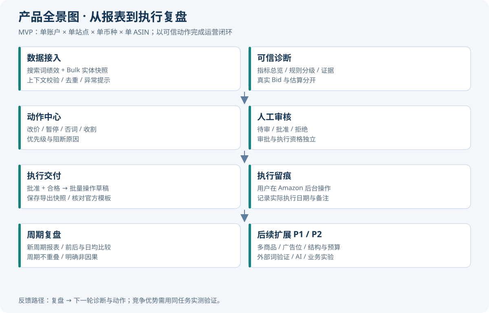
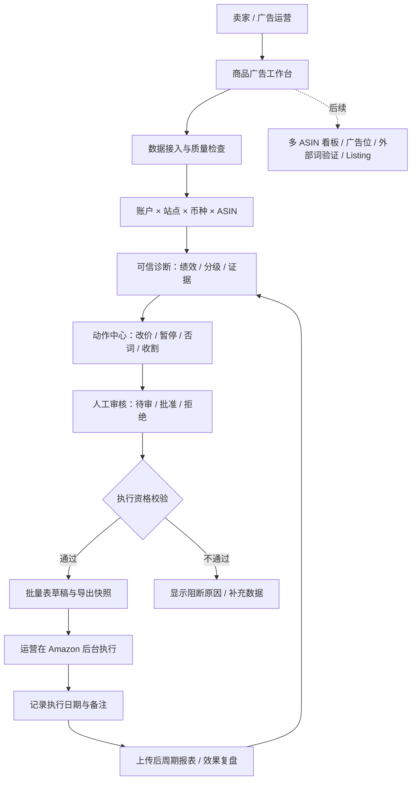

# 亚马逊广告优化助手：MVP 产品方案

版本：v1.0 ｜ 日期：2026-10-30 ｜ 项目：amazon-ppc-keyword-optimizer

## 1. 产品决策

核心任务：让亚马逊 SP 广告运营从一份已筛选商品的搜索词报表出发，完成可信诊断、逐项审核、批量操作草稿、执行记录和周期复盘。先做到每一个动作都有证据、作用范围和操作记录，再扩展外部挖词与全链路经营。

目标用户：自行运营广告的中小卖家、负责多个商品的广告运营。首版以本地单人工作台交付，每次方案明确归属一个账户、站点、币种和 ASIN。首次使用可以没有批量表，但只能得到参考建议；提供含真实出价与实体 ID 的批量表后，解锁符合条件的执行草稿。

对用户的承诺：看得懂为什么改，明确知道改哪里，审核后可以交接执行，执行后能比较结果。降低 ACoS、提高销量属于需通过真实业务实验验证的结果，不预先承诺固定增长率。

## 2. 竞品核心与取舍

| 维度 | YICOPY 公开能力 | 本产品 MVP | 后续路线 |
|---|---|---|---|
| 数据输入 | 推广商品、搜索词、广告位三份 SP 报表 | 搜索词绩效 + Bulk 实体/真实 Bid；限定单商品上下文 | 三报表分别建模关联 |
| 分析交付 | ASIN 看板、核心词和分层方案 | 单 ASIN 绩效、规则证据、优先级动作 | 商品优先级、广告位与多周期 |
| 执行 | 预算、出价、结构和上传草稿 | 有实体锚点的改价/暂停/否词/收割草稿 | 创建完整 Campaign/Ad Group、预算写回 |
| 关键词 | 意图挖掘、收录和机会双测试 | 历史已出单词收割；AI 辅助结果不直接执行 | 外部数据、相关性及机会验证 |
| 复盘 | 官网提出周期迭代 | 保存方案、审核、导出、人工执行时间和前后周期比较 | 控制组和长期实验 |

竞品来源：[全景广告作战](https://yicopy.com/features/sp-panoramic-ads)、[销词魔盒](https://yicopy.com/features/keyword-magic-box)、[出单概率测试](https://yicopy.com/features/keyword-sales-probability-test)。本方案依据公开页面，未完成其付费后台实测。首页份额可用于机会评分，但不能直接视为经过校准的成交概率。

## 3. 产品全景图

## 4. MVP 范围与用户旅程

1. 创建方案：填写账户标识、站点、币种、ASIN、目标 ACoS 和每日预算。上传已筛选为该商品的搜索词报告，可补充当前 Bulk 文件。
2. 查看数据质量：显示有效记录、重复或异常处理、上下文可信程度、缺失真实出价及无法关联实体的提示。混合商品或混合币种不得静默合并。
3. 查看诊断：展现花费、销售额、订单、点击和 ACoS；动作按优先级展示原始指标、理由与适用范围。零销售时 ACoS 显示为空或无销售，不能显示成 0%。
4. 审核动作：每项默认待审核。用户逐项批准或拒绝；系统阻断的动作即使批准也不能进入执行文件。改变主意可恢复待审。
5. 导出草稿：仅导出已批准且满足校验的动作。输出前提示需要核对当前站点官方模板。导出内容、动作版本和时间留存；未批准动作不得混入。
6. 实际执行：用户自行在广告后台上传，确认成功后记录执行日期与备注。导出成功不代表 Amazon 已接受或已执行。
7. 周期复盘：填写新的观察周期并上传同商品报表，比较总额与可比较的日均指标。周期长度不同必须说明；无广告订单不推断自然订单变化；前后变化不等于因果效果。

首版不包含：账号支付、多用户权限、Amazon API 自动调价、整账户自动归因、多 ASIN 自动拆分、外部爬取、神经网络预测、图片视频创作、完整八级广告结构自动搭建。预算分配首先作为建议展示，明确不进入自动预算变更。

## 5. 产品需求与优先级

优先级按依赖与业务风险排序：P0 是闭环必需，P1 提升运营效率，P2 建立数据与决策差异。表内边界在编码前确定；任何范围变化需先更新边界，再修改代码与测试。

| ID | 优先级 | 用户需求及交付 | 依赖 | 预先规定的测试边界 |
|---|---|---|---|---|
| M01 | P0-1 | 每份方案绑定账户/站点/币种/ASIN，可靠解析搜索词 | 无 | 必填为空、混合 ASIN/币种、同名词跨账户、缺 ASIN 列显式声明、空文件、非有限/负指标、重复行；不能静默混合 |
| M02 | P0-2 | 导入 Bulk，关联真实 Bid 与实体 ID | M01 | Keyword 与负词/广告组实体区分；大小写和连续空格规范化但保留词边界；零 Bid、冲突 Bid、缺 ID、同词不同组；歧义必须阻断 |
| M03 | P0-3 | 生成可解释调价/暂停/否词/收割动作 | M01,M02 | 阈值两侧及等号、无订单不提价、涨跌幅限制、低于出价下限、同组优质词保护、跨组重复不自动判定应否词；证据和范围完整 |
| M04 | P0-4 | 保存方案并逐项审核，刷新后可恢复 | M03 | 默认 pending；非法状态、未知方案和动作 ID、跨方案动作、重复审核；数据库重开状态一致 |
| M05 | P0-5 | 只导出批准且合格的批量操作草稿 | M02,M04 | 无审核、被拒绝、估算 Bid、缺父 ID、Update 缺 Keyword ID 均不得执行；暂停 State、否词匹配类型、换行和引号转义；重复导出内容一致 |
| M06 | P0-6 | 记录实际执行，保存导出与审核轨迹 | M05 | 未导出不能记为执行；日期非法、重复提交、执行后改变动作；确保导出与执行快照可追溯 |
| M07 | P0-7 | 上传执行后周期并复盘 | M06 | 执行前周期、重叠周期、不同上下文、零分母、不同观察天数、空报表；输出变化与非因果说明 |
| M08 | P0-8 | 全流程中文工作台与错误提示 | M01—M07 | 网络失败、重复点击、刷新历史、HTML 注入文本、无动作、全部被阻断、审批与导出状态同步 |
| M09 | P1-1 | 推广商品/搜索词/广告位分别建模并关联 | M01 | 三份报告指标不相加；多 ASIN 组无法分配时阻断；归因窗口一致 |
| M10 | P1-2 | 生成活动/组结构、预算与商品定向计划 | M02,M09 | 总预算约束、最低预算、关键词与 ASIN 类型区分、创建顺序和临时 ID 关系、预算变更审核 |
| M11 | P1-3 | AI 基于数据解释与语义分组 | M03,M04 | 不得覆盖规则阻断；缺证据不编造指标；超时/坏 JSON/无模型可降级；输入与结果版本一致 |
| M12 | P1-4 | 多商品任务队列与优先级看板 | M09 | 跨商品权限/上下文隔离、分页选择、批量任务失败恢复 |
| M13 | P2-1 | 外部关键词发现与资格/机会验证 | M09,M11 | 数据来源/时间/站点可追溯；检索未出现不能武断等同不收录；概率需校准与验证 |
| M14 | P2-2 | 业务实验与优化模型 | M07,M13 | 归因延迟、季节促销、价格库存干扰、对照组、最小样本和停止条件；无显著证据不宣传提升 |

## 6. 动作产品规则

- 改价：优先使用同一实体的真实 Bid，显示原值、建议值、绝对差和原因。估算只用于参考，禁止直接进入执行文件。
- 暂停：需要明确 Keyword ID 和父实体，操作结果为 paused；不把“降价或暂停”这类含糊文本直接转换成确定操作。
- 否词：明确精准/词组与应用广告组。与同范围已验证优质搜索词冲突时阻断；全局亏损词根只能作为待研究线索，不能自动应用全账户。
- 收割：来源词有订单与可接受 ACoS，明确目标广告组、匹配类型和新增 Bid；同一目标范围查重。与源投放完全相同的词不重复建议。
- 重复覆盖：报告中同词出现多个位置，不能证明拍卖自竞争。先提示表现差异，后续再结合结构与实验判断。
- 预算：首版按证据生成分配参考，满足合计约束；这是经营建议，并未调整 Amazon 后台预算。

## 7. 页面与信息架构

| 页面区域 | 主要内容 | 用户下一步 |
|---|---|---|
| 历史方案 | 创建时间、商品、状态 | 打开或新建 |
| 新建方案 | 上下文、绩效报表、Bulk、参数 | 分析 |
| 诊断总览 | 指标、质量提示、预算参考 | 看动作 |
| 动作审核 | 类型、实体、Bid、证据、状态和阻断原因 | 批准/拒绝 |
| 导出与执行 | 批准数、可导出数、模板状态、执行备注 | 导出/记录 |
| 周期复盘 | 后周期文件、日期、前后指标 | 制定下一轮 |

## 8. 争取超过竞品的衡量方式

“赶超”是目标，需要同任务实测。首版先建立以下验收指标，不用功能数量证明竞争优势。

| 维度 | MVP 发布门槛 | 对标验证方法 |
|---|---|---|
| 动作可靠性 | 已知测试集中跨上下文、无 ID、估算 Bid、冲突否词误导出为 0 | 同一组脱敏报表，人工核对输出 |
| 可解释性 | 所有动作均有理由、证据、商品与实体范围 | 随机抽查每种动作 |
| 可追溯性 | 每次导出能关联方案、审核快照、时间；执行另行记录 | 关闭再打开工作台核验 |
| 操作效率 | 以 10,000 行和 100 条动作建立耗时基线，记录硬件与峰值内存 | 同机器同文件比较端到端任务时间 |
| 实际可上传性 | 真实站点模板一致性校验后，再进行卖家后台人工小样验收 | 以 Amazon 返回的处理结果为准 |
| 经营效果 | 完成至少一个符合预设周期的试点，记录 ACoS、订单、花费与外部干扰 | 不预设必然改善，不用个案推广为普适结果 |

发布分两层：工程 MVP 通过自动回归与本地操作验收；业务试点版再通过真实模板与卖家后台小样验证。没有竞品实测与业务样本时，不标注“已超过 YICOPY”。

## 9. 迭代节奏

第一阶段完成 M01—M03，先解决数据归属和建议可信；第二阶段完成 M04—M06，做到审核、导出和执行留痕；第三阶段完成 M07—M08并联合验收，形成可试用版本。每项均遵循：明确输入/异常/验收边界 → 写失败用例 → 实现 → 运行相关回归 → 更新验证记录。估工在真实报表样本和模板到位后重新评估。

本地数据说明：数据保存在本机工作区；首版适合本机单人使用。公开部署前需要另行完成身份权限、隔离、上传限额和审计管理。

## 10. 当前实现状态（2026-10-30）

P0 的 M01—M08 已有可运行版本：工作台位于 `/workflow.html`，后端为 `/api/workflow`。搜索词与 Bulk 分开使用；建议出价按真实出价向盈利上限调整；任一已批准动作不满足执行条件时，整份批量草稿会被拒绝。执行日期使用 `YYYY-MM-DD`，复盘要求报告含 ASIN 与币种列，且周期不与基线重叠。

自动测试 46 项通过。M09 已实现：推广商品报告和广告位报告可选上传，指标单独展示且不并入搜索词花费；归因窗口冲突会拒绝分析；一个广告组出现多个 ASIN 时，该组动作不能导出。浏览器人工流程、Amazon 官方模板上传和经营效果仍未验证，因此不能称为已经超过 YICOPY。P1 剩余的广告结构创建、AI 解释和多商品看板，以及 P2 的外部词验证，尚未开发。
