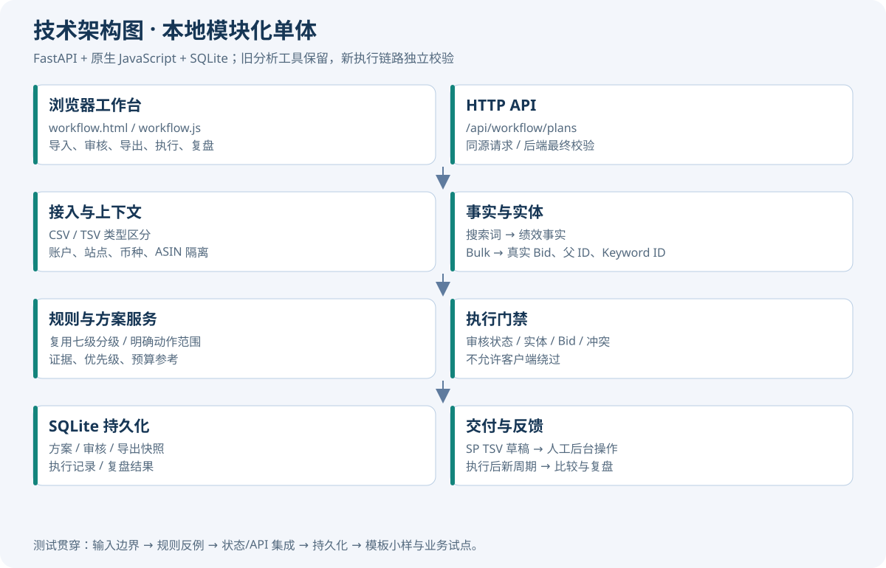
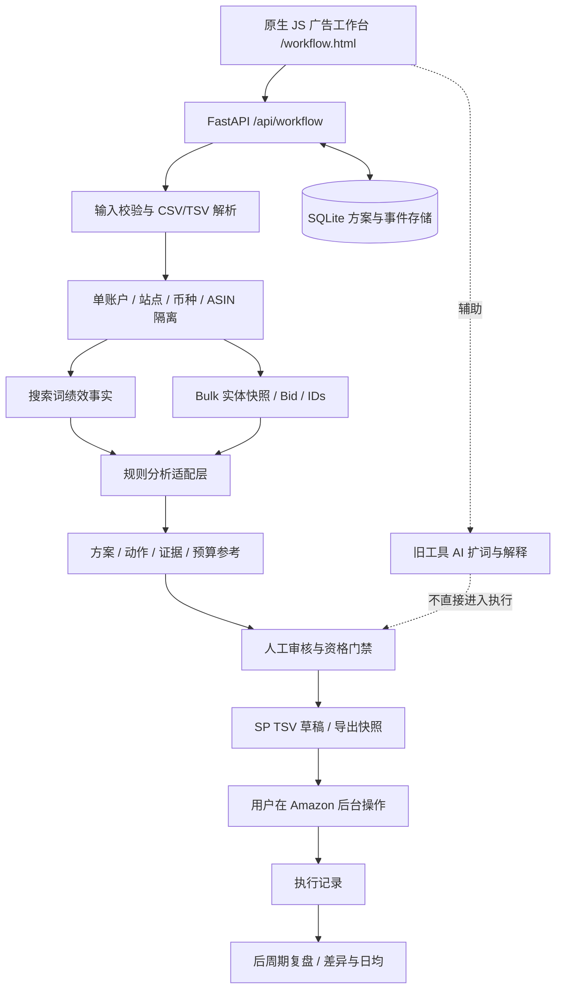

# 亚马逊广告优化助手：项目技术文档

版本：v1.0 ｜ 日期：2026-10-30 ｜ 对应产品方案：MVP-产品方案.md

## 1. 架构决策与系统边界

沿用 Python/FastAPI 和原生 JavaScript，不引入微服务、消息队列或复杂前端框架。增加独立 workflow 模块、SQLite 持久化和新工作台，以低迁移成本建立执行闭环。legacy 分析入口保留，用于旧流程和回归；执行级方案采用更严格的数据校验，不把旧接口输出直接当成可执行命令。

运行模式：本机单人、同源静态页面与 API。服务绑定 127.0.0.1；账户字符串只是数据归属标识，不代表已实现租户权限。生产多租户部署、外网访问与自动调用 Amazon 写接口不在当前发布边界。

## 2. 技术架构图





## 3. 数据模型与身份

Context = account + marketplace + currency + asin。每份方案只允许一个 Context，方案和报表不可跨 Context 复用。广告活动名称并非全局 ID；有 ID 时以实体 ID 建立操作锚点，名称只作为展示和交叉校验。

| 对象 | 关键字段 | 约束 |
|---|---|---|
| Plan | id、created_at、context、status、metrics、warnings、actions、budget、execution、review | UUID；持久化；读取不依赖前端状态 |
| Report evidence | 文件指纹/报告周期/来源、原始或归一化指标 | 绩效只来自搜索词；Bulk 不参与绩效相加 |
| Action | id、kind、keyword、campaign、ad_group、match_type、current_bid、proposed_bid、reason、evidence、priority、status、exportable、blocking_reasons | 默认 pending；审核状态与执行资格独立 |
| Entity anchor | Campaign ID、Ad Group ID、Keyword ID、真实 Bid | Update 必须指向真实 Keyword；不猜测 ID |
| Budget | daily_total、allocations、advisory | 合计不能超出总额；advisory=true，不默认写回后台 |
| Export snapshot | 方案/动作版本、内容或摘要、导出时间 | 记录审核后的确定内容；重复导出内容稳定 |
| Execution | executed_at、notes、关联导出 | 表示用户确认已执行；不由下载触发 |
| Review | 周期、后周期指标、前后变化、解释 | 必须在执行后且不重叠；不宣称因果 |

SQLite 以 JSON 方案快照加版本化事件组织，MVP 避免过度拆表。后续多用户并发时迁移 PostgreSQL，并将报告、动作、审核和导出拆成有外键的表。数据库默认目录 backend/data，可通过 PPC_DB_PATH 指定；不将真实经营数据提交版本库。

## 4. 报表导入与质量门禁

搜索词报告支持 CSV/TXT，编码优先 UTF-8，可兼容原项目 GB18030；Bulk 支持 CSV/TSV。首版 XLSX 若未实现则明确拒绝，不能将二进制内容当作 CSV。

- 用户提交上下文；报告含可识别 ASIN/币种列时交叉核验。明确多商品或多币种不进行隐式汇总。
- 原始搜索词报告可能不带 ASIN，尤其一个广告组包含多个商品时无法从该报表精确归属。无商品列时仅接受用户已预筛选的声明，并持续显示未独立验证的提示；这一限制不能被理解成完成自动归因。
- 仅搜索词产生绩效事实。Bulk 是当前实体快照；不与绩效报告拼接计数。推广商品与广告位报表留待 P1 独立事实表接入。
- 去重采用稳定的指标行/文件指纹，保留提示。重叠周期汇总报告不能仅靠行指纹解决，检测到可识别重叠要阻断；无法判断时明确输入限制。
- 数值拒绝负数、NaN 和 Infinity。空值按字段定义处理，关键指标缺失不可静默伪造成确定结论。
- 实体文本规范化仅大小写、首尾和连续空白。保留词边界，不沿用把所有空格删除的全局 canon 作为实体关联键。
- 同实体出现冲突 Bid/ID 时不采用“最后一条胜出”；执行流程需要用户消除歧义。
- 金额运算在边界处以两位小数格式化；涉及大批量预算分配使用最小货币单位或 Decimal，最后处理尾差。不同币种不换算后混用。

## 5. 规则引擎与执行门禁

复用七级分级、绩效聚合和部分收割逻辑，但为闭环增加商品和实体范围。历史阈值是运营启发式规则，不是统计显著性证明。无订单的小样本可以提示观察，不能当作已经验证无需求。

参考出价上限 = 目标 ACoS × 客单价 × 历史转化率。这个值依赖历史表现，不保证未来盈利。真实 Bid 与实际 CPC 分开存储。基于真实 Bid 截断涨跌幅，再检查最低出价，金额和幅度必须一致；如果改价的方向与实际 Bid 不符，应变为维持或重新判断，不能沿用文字标签。

执行资格是后端判定：

```text
eligible(action) = 已批准
  AND 上下文有效
  AND 实体关联唯一
  AND 操作类型支持
  AND 必需 IDs 齐全
  AND 必需 Bid 为真实关联或明确推导且通过范围校验
  AND 无否词/重复创建等冲突
```

AI 给出否定建议时仅增加候选和解释，不绕过门禁。缺失真实 Bid 的改价建议即使人工批准仍不可执行。词组否定需检查同作用范围内的优质搜索词；没有明确活动/广告组的词根不会进入执行导出。跨位置覆盖本身只产生观察证据，不自动生成否词。

## 6. API 契约

新前端调用同源 API，服务端负责最终校验。错误必须可读；参数/业务校验失败通常返回 422，未知资源 404，状态冲突 409（以实现记录为准）。

| 方法 | 路径 | 输入 / 输出 |
|---|---|---|
| POST | /api/workflow/plans | multipart: search_terms 必需、bulk 可选、account/marketplace/currency/asin、target_acos=25、daily_budget=50；返回完整 Plan |
| GET | /api/workflow/plans | 历史方案摘要列表 |
| GET | /api/workflow/plans/{id} | 完整 Plan |
| PATCH | /api/workflow/plans/{id}/actions/{action_id} | JSON: status=approved/rejected/pending；返回更新 Plan |
| POST | /api/workflow/plans/{id}/export | 返回 UTF-8 SP TSV 草稿；无合格动作或存在应阻断项时返回错误 |
| POST | /api/workflow/plans/{id}/execution | JSON: executed_at ISO 日期、notes；必须已有有效导出 |
| POST | /api/workflow/plans/{id}/review | multipart: search_terms、period_start、period_end；返回含 Review 的 Plan |

Plan.actions 每项统一展示 status、exportable、blocking_reasons。前端不能仅以按钮禁用来代替服务端校验。请求期间禁用相关按钮，并在失败后恢复；从历史加载或重新分析时清空其他方案状态。

## 7. 方案状态与快照一致性

推荐流程：draft/reviewing → export_ready → exported → executed → reviewed。实际状态字符串以模块契约为准，不能把 UI 的显示文字作为执行依据。

审核前动作均为 pending。导出只读取服务器保存的审核结果，不信任客户端传入的 result。每次变更应令旧导出失效或产生新版本；记录执行时必须关联当前有效的导出。执行后原则上冻结本轮动作，下一轮应创建新方案，避免复盘对应到从未执行过的动作集合。

MVP 选择整份拒绝，不导出合格子集：任一已批准动作缺少真实出价、实体 ID 或存在冲突时，接口返回 422，不生成部分文件。前端同步禁用导出，并要求先拒绝或恢复这些动作。建议出价按真实 Bid 向盈利上限靠拢，单次最多上调 30% 或下调 50%，不把按点击成本代理算出的幅度直接乘到真实出价上。

## 8. Amazon 批量表兼容策略

首版输出 Sponsored Products 常见字段组成的 TSV 草稿：Product、Entity、Operation、Campaign ID、Ad Group ID、Keyword ID、Keyword Text、Match Type、Bid、State 等。改价为 Keyword/Update，暂停为 Keyword/Update + paused，否词为 Negative Keyword/Create，收割为 Keyword/Create + exact。

必须以目标账户当前下载的官方 Bulk 模板核对字段、枚举和文件类型。不同站点、实体和模板版本可能不同。自动测试只能证明内部字段与序列化符合约定，不能证明 Amazon 后台会接受；在拿到真实模板并完成小样上传结果验证前，产品一律称为“待模板校验的批量操作草稿”。

新建完整 Campaign/Ad Group 与预算更新不进入首版。无父 ID 不依赖活动名称猜测更新对象。TSV 使用标准 csv.writer，测试 tab、换行、引号、中文等字段；金额不能带货币符号和千分位。

## 9. 复盘口径

基线保留原报告的日期范围；无可验证日期时可以诊断，但不制造前后周期比较。复盘 period_start > executed_at，且与基线不重叠。报告自身日期若存在需落在声明周期内，商品/币种需与原方案一致。

比较花费、销售额、订单、点击、ACoS，并在不同周期长度时展示日均。基线为零时百分比变化返回空及原因；不得用无穷值代替。广告报表无法给出自然订单占比和 TACoS，缺少全店销售数据时不输出这些指标。报告变化附注：受到价格、库存、促销、季节、竞品和归因延迟等影响，前后差异不等于本方案造成的净增益。

## 10. 测试策略与发布门槛

每个需求先规定输入、等号和上下界、异常、状态变化、输出与不覆盖范围，再写测试。已有 legacy 回归应保持通过。执行链路属于会改变广告操作内容的关键逻辑，需要服务端集成测试覆盖，而不是只做页面快照。

| 层次 | 覆盖重点 | 发布标准 |
|---|---|---|
| 解析单测 | 表头、编码、数值、重复、上下文冲突、实体歧义 | 预设用例通过 |
| 规则单测 | 阈值、Bid 方向与限制、优质词保护、收割查重 | 预设反例无误导出 |
| 状态/API 集成 | 导入→审核→导出→执行→复盘；错误顺序和未知资源 | 正常与拒绝路径通过 |
| 持久化 | 重开数据库、方案隔离、导出快照 | 刷新/重启不丢审核 |
| 前端 | 语法、DOM、网络异常、XSS 文本、完整任务 | 自动可测与人工待测分开记录 |
| 模板/业务试点 | 真实 Bulk 模板及后台小样 | 未验证不得宣称已可直接上传或已提高收益 |
| 性能 | 1万/10万行固定数据集，记录设备与耗时 | 先建立基线，再设有证据的性能承诺 |

测试记录详见 MVP-测试边界与验证记录.md、MVP-前端测试边界.md。不能将未运行的测试记为通过，也不能通过删除失败断言来达标。

## 11. 项目目录和运行

```text
backend/app/engine/           现有规则引擎
backend/app/workflow/         上下文、方案、持久化、导出与复盘
backend/app/api/workflow.py   新 API 路由
backend/tests/test_workflow.py 新闭环回归
frontend/workflow.html        新工作台
frontend/workflow.js          请求、审核、历史与复盘交互
frontend/workflow.css         工作台样式
backend/data/                 本地运行数据（忽略提交）
docs/                        产品、架构、边界与验证记录
```

常规安装和运行：

```powershell
cd backend
python -m pip install -r requirements.txt
python -m pytest -q
python -m uvicorn app.main:app --host 127.0.0.1 --port 8787
# 打开 http://127.0.0.1:8787/workflow.html
```

当前会话采用项目内 .deps 隔离依赖；验证命令和实际结果记录在交付记录中。这里的 8787 是运行示例，不表示已启动服务。

## 12. 后续技术路线

P1：引入分类型报告 schema、显式映射和广告组/商品关系，多 ASIN 归因与广告位分析；建立动作类型化模型、乐观并发版本和原子事务；完成真实模板适配和结构创建；AI 输出通过 schema 与事实证据校验。

P2：合规可追溯的数据来源、关键词机会评分、长期试验数据与概率校准。扩展多用户前补充身份权限、租户隔离、上传配额、脱敏日志与数据库迁移，不将本地单人工具直接暴露公网。
