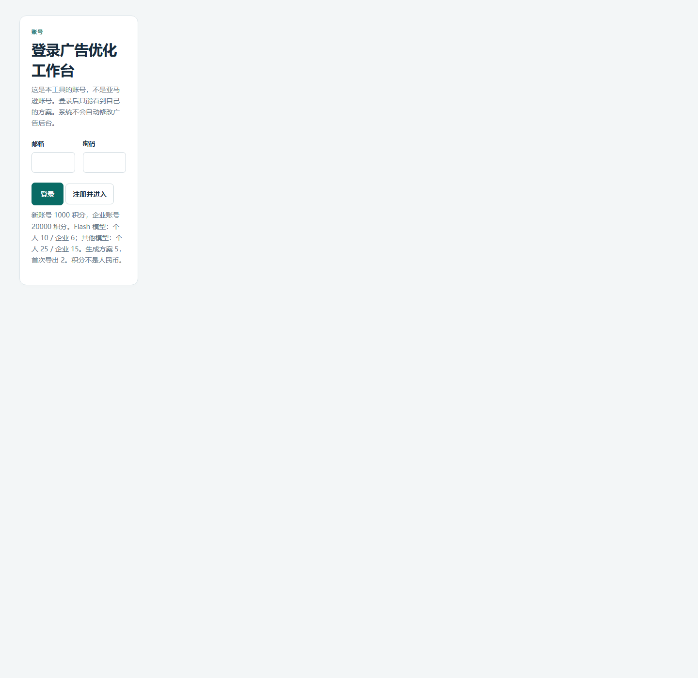
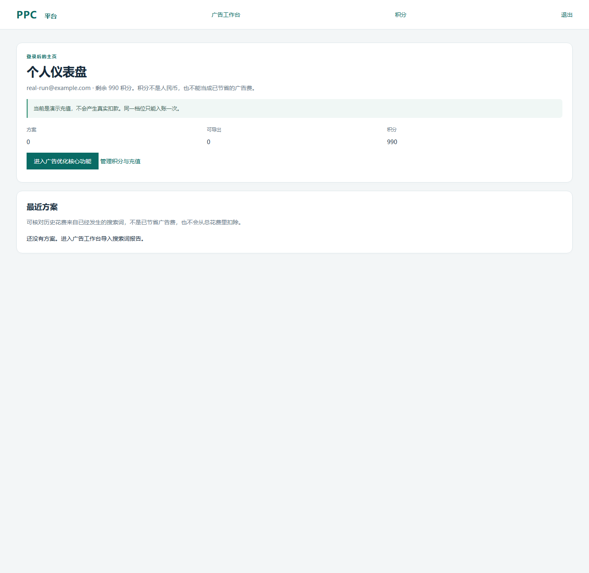
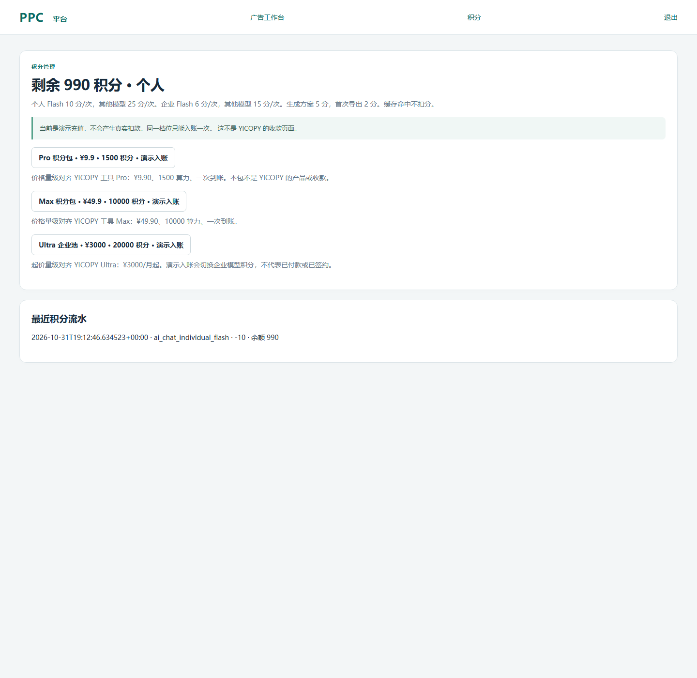
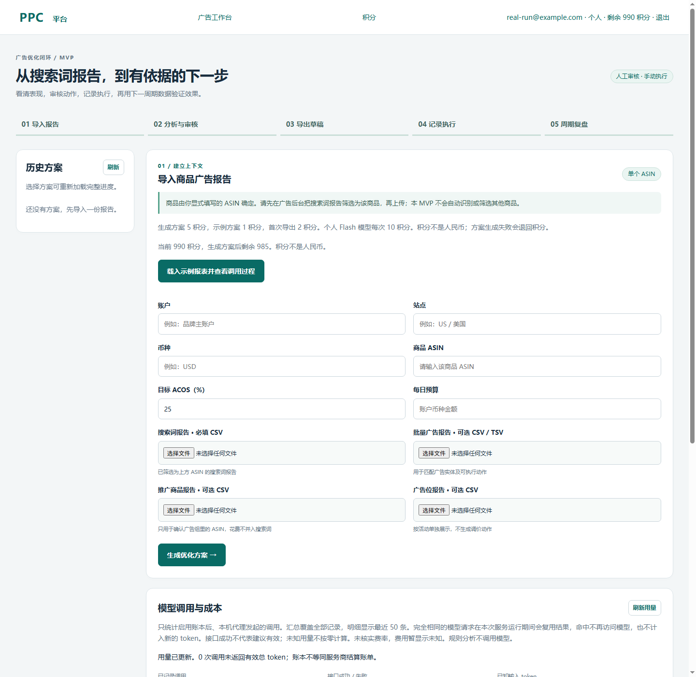

# 当前原型与一次真实模型调用

记录时间：2026-11-01。页面来自正在运行的本地服务 `http://127.0.0.1:8790/`。截图账号是本机测试账号 `real-run@example.com`，不是亚马逊账号。

## 产品现在长什么样

登录后先到仪表盘，再进广告工作台或积分页。工作台仍是人工审核、手动执行，不会登录亚马逊，也不会自动改广告。

登录页说明这是本工具账号，并列出个人 1000 积分、企业 20000 积分，以及模型和服务的积分价。

仪表盘显示账号、剩余积分、方案数量，并写明演示充值不会产生真实扣款。

积分页列出 Pro、Max、Ultra 三档标价。这些价格只对齐 YICOPY 公开档位，不是 YICOPY 的收款，也还没有真实支付。

工作台在导入前显示生成方案 5 积分、示例 1 积分、首次导出 2 积分，以及当前余额够不够。

## 这次真实模型调用

本机保存的模型密钥由服务端使用，没有写进页面，也没有进入本次记录。调用走本地代理 `POST /api/ai/chat`，返回 HTTP 200，缓存未命中。

输入不是广告花费报告。下载目录里的 `测试-B089K9L3VY-20261025_2026-10-27.xlsx` 是竞品关键词表，共 1685 行，字段是关键词、来源和建议用法。本次只把使用次数最高的前 40 个词和 ASIN `B089K9L3VY` 发给模型。表里没有点击、花费、订单或 ACOS。

服务商返回的用量：输入 337 token，输出 7728 token，其中推理 7177 token，合计 8065 token。个人 Flash 模型扣了 10 积分，余额从 1000 变为 990。人民币费用仍然未知，不能把 token 或积分换成广告节省。

模型给出 12 个扩展词，例如 foldable phone stand for desk、aluminum phone stand for travel、270 degree rotating phone stand。它还建议否定 cell phone、samsung galaxy、samsung tab、google nexus、and tablet。这些否定只是模型意见：手机支架本身要兼容手机和平板，直接否定设备词可能挡掉相关流量，不能当已批准动作，也不能导出。

仓库里的搜索词报表示例仍然是保温杯示例，不是这份 ASIN 的广告投放结果。因此这次没有生成可上传的广告草稿。
